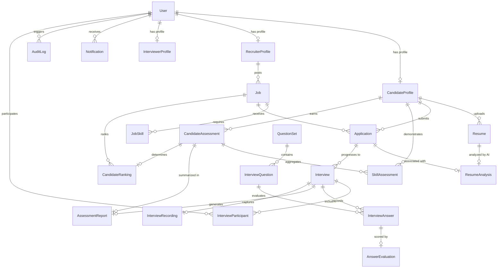

# Database Entity-Relationship (ER) Architecture
## AI-Based Online Interview and Candidate Assessment Platform

### Normalized Entity List (23 Entities)

1. **User**: Authentication, credentials (bcrypt), role (`ADMIN`, `RECRUITER`, `INTERVIEWER`, `CANDIDATE`), active status.
2. **CandidateProfile**: Personal info, education, current title, phone, LinkedIn, GitHub, portfolio URL.
3. **RecruiterProfile**: Company name, department, designation, contact info.
4. **InterviewerProfile**: Specialization, technical domain, years of experience.
5. **Job**: Vacancy requisitions, role title, department, salary, experience range, status (`DRAFT`, `PUBLISHED`, `CLOSED`).
6. **JobSkill**: Skill requirement mapping for jobs with importance weight and minimum proficiency.
7. **Application**: Linking candidate to a job, current status (`APPLIED`, `SHORTLISTED`, `INTERVIEW_SCHEDULED`, `REJECTED`, `OFFERED`).
8. **Resume**: File metadata, file path, mime type, uploaded timestamp.
9. **ResumeAnalysis**: AI-extracted skills, matched skills, missing skills, semantic compatibility score, explanation.
10. **Interview**: Scheduled interview sessions, mode (`VIDEO`, `AI_ASSISTED`, `TECHNICAL`), scheduled time, status (`SCHEDULED`, `IN_PROGRESS`, `COMPLETED`, `CANCELLED`).
11. **InterviewParticipant**: Many-to-many relationship linking candidates, recruiters, and interviewers to an interview room.
12. **InterviewSlot**: Available availability windows for interviewers to prevent booking conflicts.
13. **InterviewQuestion**: Specific interview questions, difficulty, category, expected concepts, maximum score.
14. **QuestionSet**: Curated bank or template of questions mapped to specific job roles or skill sets.
15. **InterviewAnswer**: Submitted answers (text or transcribed audio) by candidate during interview or test.
16. **AnswerEvaluation**: AI scoring breakdown (Technical correctness, Semantic relevance, Conceptual understanding, Completeness, Keyword coverage) + Human override notes.
17. **SkillAssessment**: Normalized candidate score for a specific skill (e.g. React: 85%, Node.js: 90%).
18. **CandidateAssessment**: Aggregate assessment session score combining test, interview, and resume score.
19. **CandidateRanking**: Multi-candidate comparative rank within a specific job requisition.
20. **InterviewRecording**: Recording file pointer, consent status, retention expiry date.
21. **Notification**: In-app notifications with read/unread status, category, action links.
22. **AssessmentReport**: Generated audit-ready evaluation report data and PDF path.
23. **AuditLog**: Platform-wide security audit trail (action, actor, entity, IP, timestamp).

---

### Entity Relationship Diagram (Mermaid)

